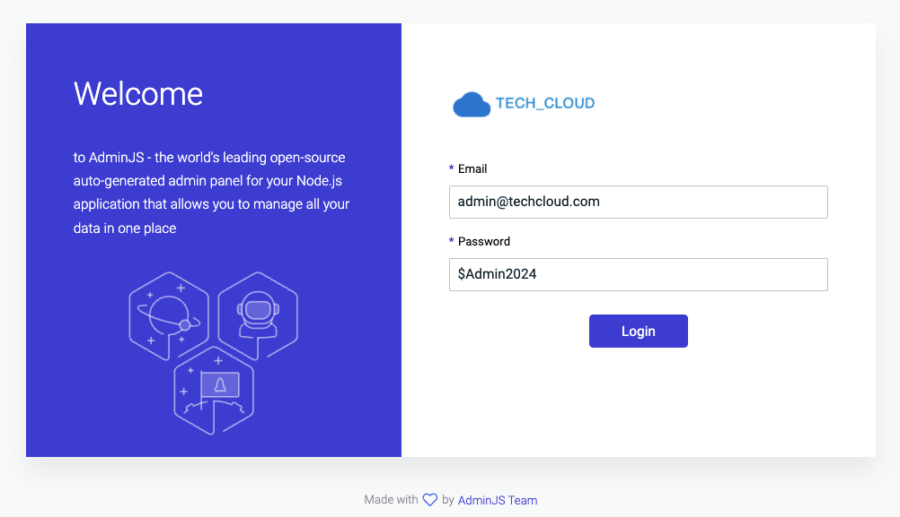
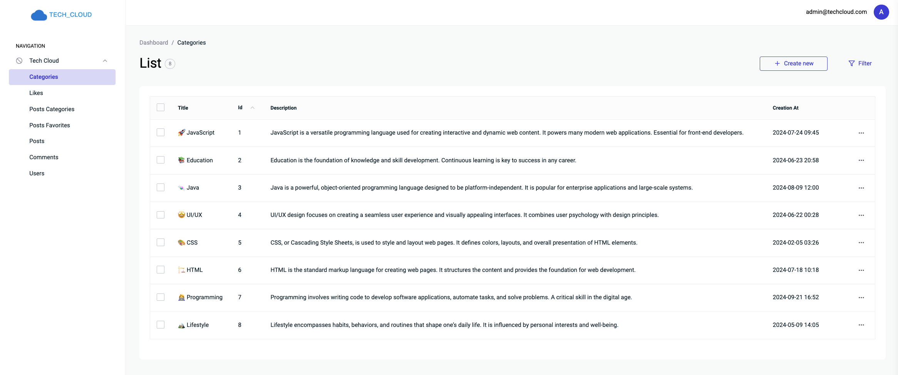

# USOF Backend API

## Short Description
This project is a backend API built with Express.js for a platform similar to Stack Overflow, named **USOF**. The API allows users to register, log in, post questions, add comments, like/dislike posts, and manage other interactions.

## Screenshots of Solution
Please refer to the `docs/openapi.json` file for detailed API documentation and example screenshots of the solution in action.

## Requirements and Dependencies
- **Node.JS** >= v22
- **NPM** >= v10
- **MySQL** >= 8.0

Before starting, ensure the required technologies are installed.

## Database Setup
The database schema is provided in the `config/db.sql` file. Run the SQL commands in your MySQL database to set up the required tables.

## How to Run the Solution
1. Clone this repository and move to the project directory.
   ```bash
   git clone <repository-url>
   ```
2. Install the dependencies.
   ```bash
   npm install
   ```
5. Configure the database connection by updating the `.env` file with your MySQL database credentials. Example:
   ```
   DATABASE_HOST=localhost
   DATABASE_PORT=3306
   DATABASE_USER=root
   DATABASE_PASSWORD=root
   DATABASE_NAME=usof_irepeshko
   ```

5. Run the database schema script in MySQL to set up the database:
   ```sql
   source config/db.sql;
   ```
6. Start the server.
   ```bash
   npm run start
   ```

## REST API documentation
The documentation of all available endpoints can be found [http://localhost:8080/api-docs/](http://localhost:8080/api-docs/). The [Swagger](https://swagger.io/) library is used.


## Admin Panel
The admin panel are available [http://localhost:8080/admin/](http://localhost:8080/admin/). The [AdminJS](https://adminjs.co/) library is used.





## Additional Features
- Favorite posts - users can add posts to favorites and see this list.
- Most useful comment - the author of the post can set the most useful comments that solved their problem described in the post. Only post authors can set this value.
- Most interesting posts - administrators can select the posts that will be displayed on the main page of the site. Usually these are the most interesting posts.

## Full Documentation
This project follows Challenge-Based Learning (CBL) principles. Each phase of the challenge (Engage, Investigate, Act) is documented to help analyze the project's progress and implementation steps. The full documentation includes:
- Descriptions of progress for each completed CBL stage.
- An algorithm of the program's logic and functionality.

## Fake Data
All users with role `user` has password: `$User2024`. It's fake data for presentations.

### Admin for presentations
   ```text
      login: admin
      password: admin@gmail.com
      password: $Admin2024
   ```
